  

  <pre align="center" style="background: transparent; border: none; padding: 0;">
██████╗ ███████╗████████╗███████╗██████╗ 
██╔══██╗██╔════╝╚══██╔══╝██╔════╝██╔══██╗
██████╔╝█████╗     ██║   █████╗  ██████╔╝
██╔═══╝ ██╔══╝     ██║   ██╔══╝  ██╔══██╗
██║     ███████╗   ██║   ███████╗██║  ██║
╚═╝     ╚══════╝   ╚═╝   ╚══════╝╚═╝  ╚═╝
  </pre>

  

  

  

<picture data-importer="pacman">
  <source media="(prefers-color-scheme: dark)" srcset="https://raw.githubusercontent.com/CilZett/CilZett/pacman-output/pacman-contribution-graph-dark.svg?game=pacman">
  <source media="(prefers-color-scheme: light)" srcset="https://raw.githubusercontent.com/CilZett/CilZett/pacman-output/pacman-contribution-graph.svg?game=pacman">
  
</picture>

###
